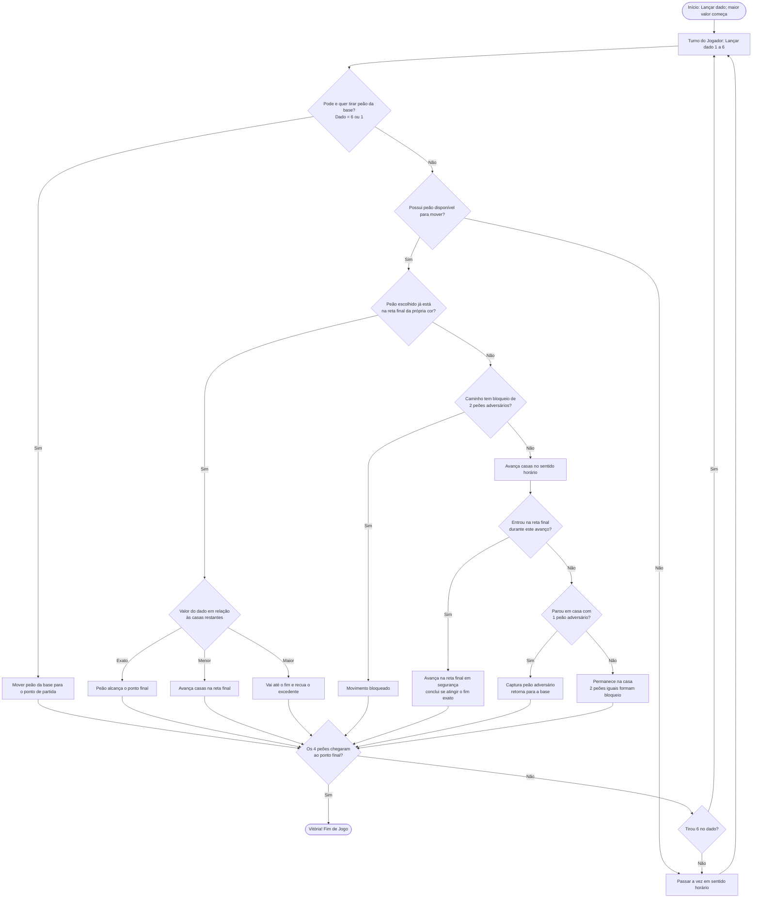

# Desafio de Testes: Ludo (`desafio_teste_ludo`)

Este documento consolida todas as regras de negócio, requisitos de entrega, fluxo de execução e matriz de casos de teste para a implementação da suíte de testes do jogo **Ludo** em JavaScript.

---

## 1. Requisitos e Regras de Entrega

* **Prazo de entrega:** Até **22/11/2026 às 23:59**.
* **Link de entrega:** [Formulário Oficial de Entrega](https://forms.gle/bgbV2TwrreR8LiAGA) *(O desafio não será aceito caso esteja em discordância com o padrão de entrega).*
* **Nomenclatura obrigatória do repositório:** `desafio_teste_ludo`
* **Equipe e Rastreabilidade:**
  * Pode ser realizado individualmente ou em **dupla**.
  * É obrigatório haver **commits rastreáveis de ambos os integrantes** no repositório; caso contrário, apenas o autor com contribuições registradas será avaliado.
* **Estrutura obrigatória do `README.md` do repositório:**
  1. Identificação da especificação do desafio.
  2. Explicação detalhada do funcionamento dos casos de teste (como instalar dependências e executar a suíte).
  3. Identificação completa do(s) colaborador(es).

---

## 2. Escopo Técnico do Desafio

* **Modalidade:** Partida configurada para **2 jogadores**.
* **Linguagem e Stack:** Casos de teste escritos em **JavaScript** (ex.: Jest, Mocha/Chai ou `node:test`) para validar uma implementação de regras do Ludo também em **JavaScript**.
* **Estrutura sugerida do projeto:**
  ```text
  desafio_teste_ludo/
  ├── src/
  │   └── ludo.js          # Implementação das regras e estado do jogo
  ├── tests/
  │   └── ludo.test.js     # Suíte de casos de teste em JavaScript
  ├── package.json
  └── README.md
  ```

---

## 3. Regras do Jogo (Base de Negócio)

### 3.1. Preparação e Início da Partida
* **Tabuleiro e Peças:** Tabuleiro quadrado com percurso em forma de cruz. Cada um dos **2 jogadores** possui **4 peões** da sua respectiva cor, posicionados inicialmente na sua base.
* **Ordem de Jogo:** Ambos os jogadores lançam o dado; quem obtiver o **maior número** inicia a partida. Os turnos alternam-se em **sentido horário**.

### 3.2. Saída da Base e Dado Extra
* **Saída da Base:** Para mover um peão da base inicial para a casa de partida no tabuleiro, o jogador deve tirar **6** no dado *(nota: a base de regras também cita a regra alternativa de tirar **1** ou **6** para sair da base — documente claramente no `README.md` qual variação os testes validam, garantindo suporte a `6` como padrão)*.
* **Jogada Extra:** Sempre que o jogador tirar **6** no dado, após realizar sua jogada (sair da base ou avançar um peão), tem o direito de **jogar o dado novamente**.

### 3.3. Movimentação no Percurso Comum
* Havendo pelo menos um peão no percurso, o jogador escolhe um peão ativo e o avança no **sentido horário** pela quantidade exata de casas obtida no dado.
* Se o jogador não tiver peões fora da base e não tirar o valor necessário para sair, passa a vez.

### 3.4. Captura e Bloqueio (Torre)
* **Captura:** Se um peão encerrar seu movimento em uma casa do percurso comum ocupada por **1 peão adversário**, o peão adversário é capturado e retorna imediatamente para a sua base inicial.
* **Bloqueio:** Se **2 peões da mesma cor** ocuparem a mesma casa no percurso comum, eles formam uma barreira:
  * Não podem ser capturados por peões adversários.
  * Nenhum peão adversário pode **ultrapassar ou parar** nessa casa, ficando bloqueado.

### 3.5. Reta Final e Condição de Vitória
* **Entrada na Reta Final:** Após completar uma volta inteira pelo percurso comum, o peão entra na **reta final exclusiva da sua cor** (zona segura contra capturas e bloqueios).
* **Chegada ao Ponto Final (Número Exato):** Para alcançar o ponto final central, o jogador deve tirar o **número exato** de casas restantes no dado.
  * **Valor menor:** O peão avança normalmente dentro da reta final.
  * **Valor maior (Recuo):** O peão avança até o ponto final e **recua o número de casas excedentes**, aguardando o próximo turno.
* **Vitória:** Vence a partida o primeiro jogador que conduzir todos os seus **4 peões** ao ponto de chegada da sua cor.

---

## 4. Diagrama do Fluxo de Jogo



---

## 5. Matriz de Casos de Teste Recomendados

Para garantir cobertura completa das regras na suíte de testes em JavaScript, implemente cenários cobrindo os seguintes grupos:

| ID | Categoria | Cenário de Teste | Resultado Esperado |
| :--- | :--- | :--- | :--- |
| **CT01** | Inicialização | Início de partida para 2 jogadores | Cada jogador inicia com 4 peões na base e 0 no percurso. |
| **CT02** | Inicialização | Sorteio de ordem inicial | Jogador que tirar o maior valor no dado inicia o primeiro turno. |
| **CT03** | Saída da Base | Todos os peões na base e dado diferente de 6 (ex.: 3) | Nenhum peão sai da base e o turno passa para o adversário. |
| **CT04** | Saída da Base | Peão na base e dado igual a 6 | Peão move-se da base para a casa de partida e jogador ganha jogada extra. |
| **CT05** | Movimentação | Avanço simples no percurso comum | Peão avança no sentido horário exatamente $N$ casas conforme o dado. |
| **CT06** | Dado Extra | Jogada adicional após tirar 6 | Jogador realiza o movimento e mantém o turno ativo para lançar novamente. |
| **CT07** | Captura | Parar em casa com 1 peão adversário | Peão adversário volta para sua base inicial; peão atacante ocupa a casa. |
| **CT08** | Bloqueio | Formação de torre (2 peões da mesma cor) | Dois peões aliados na mesma casa ativam estado de bloqueio. |
| **CT09** | Bloqueio | Tentativa de ultrapassar ou parar em bloqueio adversário | Movimento é impedido; peão não pode cruzar nem capturar a torre. |
| **CT10** | Reta Final | Entrada na reta final após volta completa | Peão deixa o percurso comum e ingressa na coluna exclusiva da sua cor. |
| **CT11** | Reta Final | Avanço parcial dentro da reta final | Dado menor que as casas restantes avança o peão sem concluir. |
| **CT12** | Reta Final | Chegada com número exato | Dado igual às casas restantes conclui o trajeto do peão. |
| **CT13** | Reta Final | Excesso de pontos na reta final ("bate e volta") | Peão vai até o ponto final e recua o número de casas excedentes. |
| **CT14** | Vitória | Conclusão dos 4 peões de um jogador | Partida é encerrada e o jogador é declarado vencedor. |